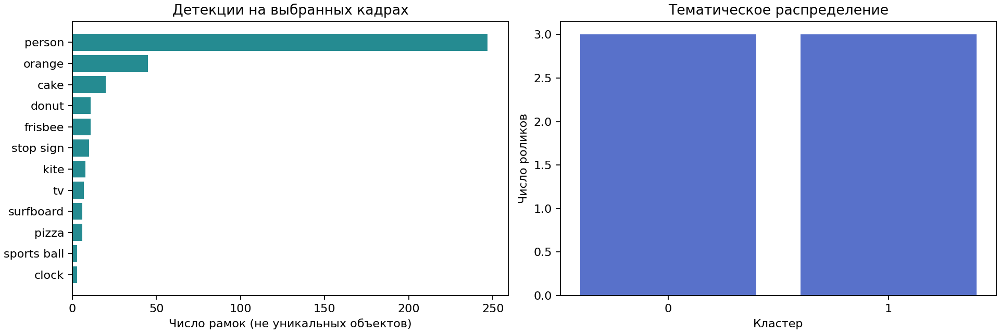
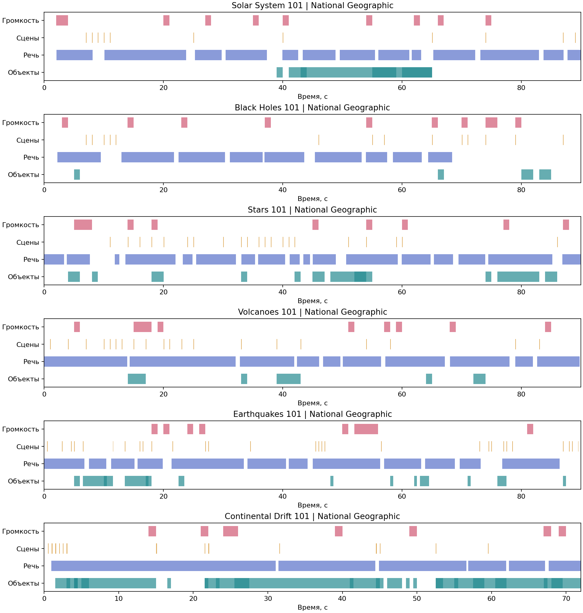

# Лабораторная работа №6 (практика 6)

## Автоматический анализ и семантическая обработка видео

Основание: lecture7_video_analysis.pptx, слайды 11, 17–21 и заметки докладчика. Цель — собрать видео, выделить визуальные и звуковые события, сгруппировать ролики и найти нужный момент.

## Полученные результаты

Успешно обработано **6** роликов, **684** кадров, **329** событий. Ошибок источников: **0**. Результаты получены запуском моделей, без подстановки разметки.

| Видео | Длительность | Шаг кадров | Кадры | Сегменты речи | События | Кластер |
|---|---:|---:|---:|---:|---:|---:|
| Solar System 101 \| National Geographic | 00:01:30.02 | 1.0 с | 90 | 17 | 42 | 0 |
| Black Holes 101 \| National Geographic | 00:01:30.02 | 1.0 с | 90 | 10 | 37 | 0 |
| Stars 101 \| National Geographic | 00:01:30.02 | 1.0 с | 90 | 24 | 67 | 0 |
| Volcanoes 101 \| National Geographic | 00:01:30.02 | 1.0 с | 90 | 21 | 55 | 1 |
| Earthquakes 101 \| National Geographic | 00:01:30.02 | 0.5 с | 180 | 15 | 65 | 1 |
| Continental Drift 101 \| National Geographic | 00:01:12.01 | 0.5 с | 144 | 17 | 63 | 1 |

## Пять артефактов из задания

1. `visual_features.csv`, `videos/*/frames.jsonl`, `videos/*/frames/*.jpg`: рамки YOLO, классы, уверенность, яркость, резкость, изменение гистограммы.
2. `events.csv`: интервалы присутствия объектов, речь, смены сцен и пики громкости.
3. `entities.csv`, `summary.png`: частоты детекций, доля кадров, интервалы и приблизительная длительность присутствия.
4. `python lab6.py serve`: поиск, плеер, кликабельная временная шкала; `timeline.png` — её статическое представление.
5. `topics.json`, `topic_assignments.csv`: темы с ключевыми словами, доли роликов, перебор k и silhouette.

## Методика и параметры

Детектор **yolov8n.pt**, порог **0.4**; ASR **Whisper base**, устройство **cpu**. Nano уменьшает затраты на CPU; base поддерживает русский и английский и подходит для коротких роликов. Порог 0.4 — исходная рабочая гипотеза из лекции, а не результат оптимизации на размеченном корпусе.

Кадры читаются потоком по PTS. Автовыбор шага: разница уменьшенных кадров в первых 8 с > 0.07 → 0.5 с; иначе 1 с, для статичных роликов длиннее 10 минут — 2 с. Интервал можно задать для каждого файла. Пилот не гарантирует обнаружение динамики в конце ролика; краткие события между отсчётами могут быть пропущены.

Граница сцены — расстояние Бхаттачарьи между HSV-гистограммами ≥ 0.45. Это эвристика монтажа, а не классификация места. Яркость — средняя интенсивность, резкость — дисперсия Лапласиана.

Звук преобразуется в PCM mono 16 kHz; громкость — RMS в окнах по 1 с, в dBFS. Пик: значение не ниже max(-35 dBFS, 90-й процентиль данного файла). Соседние окна объединяются.

Объекты одного класса объединяются только на последовательных выбранных кадрах. Граница справа — следующий отсчёт; погрешность порядка шага выборки. Детекции не являются числом уникальных людей или машин: трекинга идентичностей нет.

Текст: транскрипт, метаданные и классы объектов → русская лемматизация, русские/английские стоп-слова, TF-IDF (до 5000 признаков), KMeans (seed=42, n_init=10). k выбирается по максимуму cosine silhouette среди 2…min(6, n−1, число различных документов). Если выбор невозможен, используется один кластер. Пустые документы остаются без темы.

## Тематические группы

- Кластер 0 (50%): stars, black, solar, holes, systems, stellar, luminosity, sun, planets, hole. Ролики: Solar System 101 | National Geographic; Black Holes 101 | National Geographic; Stars 101 | National Geographic.
- Кластер 1 (50%): volcanoes, continents, plates, tectonic, earth, magma, violent, planet, ground, crust. Ролики: Volcanoes 101 | National Geographic; Earthquakes 101 | National Geographic; Continental Drift 101 | National Geographic.

Silhouette: 0.053388376352051604. На малом корпусе эта оценка не доказывает тематическую устойчивость.

## Проверка и ограничения

Стратифицированная случайная выборка визуальных событий (seed=42, по одному из первых пяти роликов) записана в `review_sample.csv`. Результат визуальной проверки и разбор тематических групп приведены в `../VALIDATION.md`, если этот файл подготовлен. Автоматические проверки целостности не подменяют просмотр кадров и прослушивание речи.

Состав данного запуска перечислен в таблице выше; источники и параметры сохранены в индексе и метаданных. Небольшой учебный набор не представляет весь видеоархив и не даёт общей оценки качества ASR. Для русских файлов поддержан параметр `--language ru`; оценки WER/mAP не заявляются без эталонной разметки.

Whisper может ошибаться на музыке, именах и коротких репликах. YOLO распознаёт только свои классы. Поиск использует леммы и словарь русских названий объектов, но не является нейросетевым поиском синонимов. Эмоции, биометрия и внимание людей не оцениваются.

## Источники и воспроизводимость

Ссылки и SHA-256 файлов сохранены в `videos/*/source.json`; исходные URL демонстрационного корпуса — в `../data/demo_sources.json`. При локальном запуске происхождение корпуса дополнительно сохранено в `../data/demo/*/source.json`. Полные промежуточные файлы включают аудио, транскрипт, метаданные и детекции. Кэш результата привязан к содержимому источника, параметрам и версии пайплайна.

Документация: [Ultralytics](https://docs.ultralytics.com/modes/predict/), [Whisper](https://github.com/openai/whisper), [yt-dlp](https://github.com/yt-dlp/yt-dlp#embedding-yt-dlp).

- Предупреждение Black Holes 101 | National Geographic: asr_quality: 5 подозрительных сегментов исключено из поиска; см. rejected_segments.json

## Дополнительный эксперимент с темами

[Сравнение с эталонными темами и группировка только по речи](TOPIC_VALIDATION.md). Оценка относится к текущему индексу; его SHA-256 записан в `topic_evaluation.json`.
